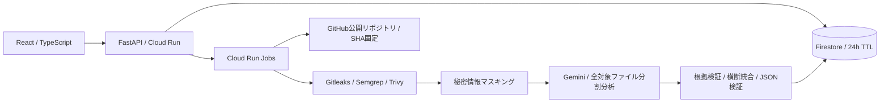

# 全体構成と実装計画

## 構成

v0.2では図の各処理を実装しています。ローカルの取得・保存・アクセス制御を検証済みです。Geminiの実API、Firestore実環境、Cloud Run Jobsの実行は、キー・クラウド構成の設定後に検証します。公開・デプロイは未実施です。

## 責務の分割

- `frontend/`：ホーム、進捗、レポート。閲覧トークンをURLや永続ストレージに保存しない方針。
- `backend/app/`：入力検証、受付、アクセス制御、状態参照、レポート出力。
- `models.py / store.py / firestore_store.py`：共通モデル、SQLite／Firestore、受付トランザクション。
- `repository.py / scanners.py / gemini.py / redaction.py`：取得、静的解析、AI分析、根拠検証、マスキング。
- `runner.py / worker.py / report.py / api.py`：実行、dispatcher、進捗、結果、日本語出力。
- ローカルはSQLite＋APIから起動する非同期タスクです。永続SQLiteと原子的なclaimを使い、複数APIの競合を防ぎます。`python -m app.worker`でも待機ジョブを実行できます。本番はFirestore＋独立したCloud Run Jobsを使います。

## 監査契約

受付時に暗号学的乱数でIDと閲覧トークンを生成し、トークンはハッシュのみ保存する。参照APIはAuthorizationヘッダーで検証する。期限切れ・不正トークン・存在しないIDには同一の404を返す。ログにトークンやコードを残さない。

監査状態は `queued / running / completed / partial / failed`。受付拒否はHTTP 429または503です。設定した静的ルールの正常実行と全対象ファイルのAI処理・横断分析・根拠検証が完了した場合のみcompletedとします。非対応言語・ルール範囲は表示します。レポートにはSHA、日時、対象・除外一覧、各ツールの実行状態・ルール範囲、AI処理範囲、重大度、分類、根拠、修正案、確信度を含めます。Dockerのツール版はDockerfileで固定しています。

共通Findingは `source, rule_id, severity, category, title, file, start_line, end_line, evidence, reason, impact, remediation, confidence, evidence_verified, github_url` を持ちます。秘密情報の値は保存しません。AI根拠は実在パス・行範囲・マスク済み引用と照合します。静的検出だけで悪用可能性を断定せず、環境依存の問題は設定確認に分類します。

## 取得とAIの制限

HTTPSのgithub.com所有者／リポジトリURLのみ受け付ける。GitHub APIで公開性とSHAを確認し、そのSHAのアーカイブを許可済みホストから取得する。リダイレクトも各段で検証。圧縮・展開後容量、ファイル数、単一ファイルサイズ、時間を制限し、絶対パス・親ディレクトリ参照・リンク・特殊ファイルを拒否する。コードやインストールスクリプトは実行しない。

Geminiは全対象コードをマスキング後に分割分析する。各ファイルの処理記録を保存し、最後に構造・呼び出し関係・静的結果を横断統合する。リポジトリ文章は信頼しないデータとして渡す。構造化JSONをスキーマ検証し、対象漏れ・予算超過・応答不正では全体完了を表示しない。AI予算は事前見積もりと各呼び出し前後の実測で管理する。

## 段階別の完了条件

1. **Phase 1**：基本UI、API基盤、設計、ローカル起動、ビルド・基本テスト。
2. **Phase 2**：安全なGitHub取得、SHA・公開性確認、容量制限、対象／除外一覧。rain-map取得を検証。
3. **Phase 3**：3ツールを隔離実行、タイムアウト、共通JSON、失敗時の未検査表示。
4. **Phase 4**：Gemini全対象分析、分割・横断統合、マスク、予算管理、JSON／根拠検証。
5. **Phase 5**：実データの日本語レポート、3分類、コミット固定リンク、Markdown／JSON。
6. **Phase 6**：非同期ワーカー、SQLite／Firestore、状態・中断・期限切れ。処理の重複を原子的なclaimで防ぐ。有料AIの自動再試行は行わない。利用者からのキャンセルAPIは将来の拡張。
7. **Phase 7**：閲覧トークン、24時間失効と削除、匿名回数制限、グローバル同時実行数・予算停止。複数インスタンスでもトランザクションで強制する。
8. **Phase 8**：Docker、Cloud Run／Jobs設定、最小権限IAM、Secret Manager、GitHub Actions WIF。公開操作は明示的指示後のみ。
9. **Phase 9**：統合・悪意あるアーカイブ・期限・失敗・予算のテスト、依存ライセンス一覧、公開手順。

## 将来の拡張

リポジトリ取得をprovider、ジョブ起動をdispatcher、保存をstoreとして分ける。OAuth／GitHub App、private repo、差分監査、PR生成、PDF、過去比較、TerminalBox連携は初期版に含めない。Google Cloudプロジェクトの初期値は `jumpeicloud` とし変更可能にする。
